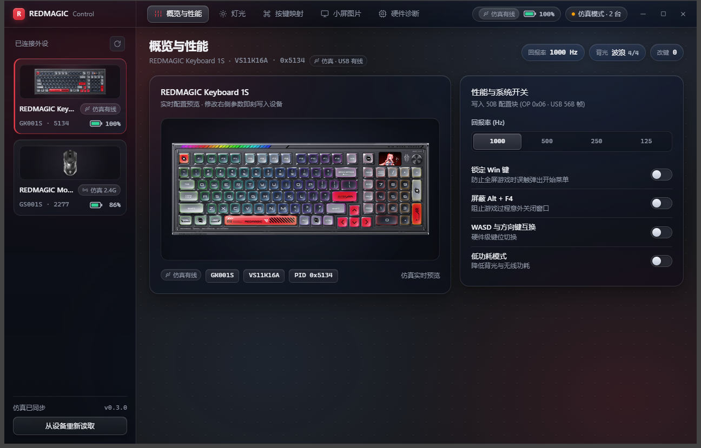
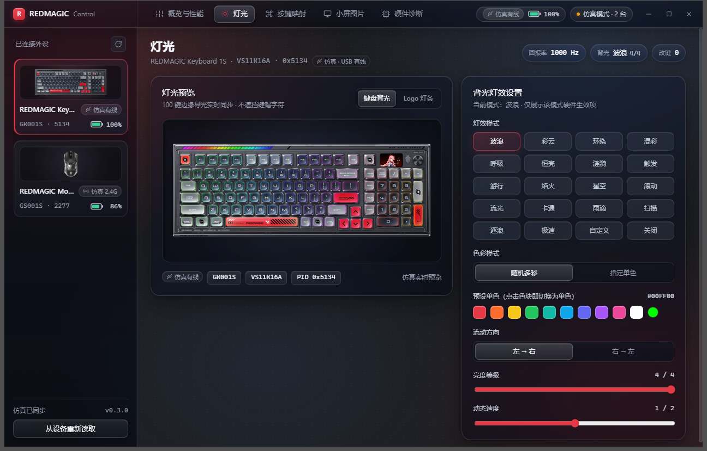
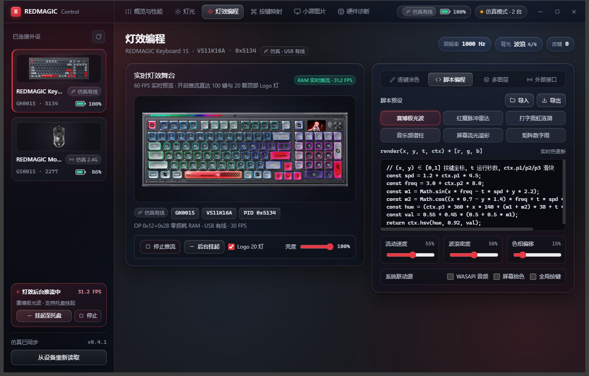
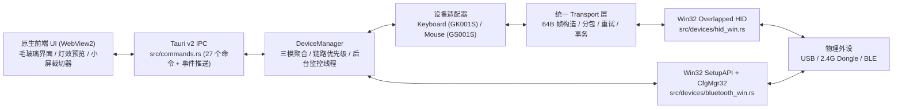

# REDMAGIC Control

轻量级红魔外设桌面控制中心 — **纯 Rust + Tauri v2** 原生实现（无 Node.js / 无 Electron / 无 C `hidapi` 运行时依赖，单文件 Release 仅约 9 MB），完整支持 **REDMAGIC 氘锋机械键盘 `GK001S`** 与 **REDMAGIC 电竞鼠标 `GS001S`** 的有线 / 2.4G / 蓝牙三模管理。

## 界面预览



| 键盘灯光管理（20 种模式 + Logo 灯条） | 320×172 小屏图片选择器与裁切工作台 |
| :---: | :---: |
|  |  |

| 灯效编程工作室（JS Shader + 零损耗 RAM 推流） | 板载逐键涂色（4 组 Flash 持久化方案） |
| :---: | :---: |
|  |  |

| GS001S 鼠标 · 5 档 DPI 与传感器控制 |
| :---: |
|  |

---

## 目录

- [界面预览](#界面预览)
- [1. 支持设备与三模能力矩阵](#1-支持设备与三模能力矩阵)
- [2. 软件架构与通信实现](#2-软件架构与通信实现)
- [3. 官方 HID 协议运作原理](#3-官方-hid-协议运作原理)
  - [3.1 64 字节固定帧格式](#31-64-字节固定帧格式)
  - [3.2 指令集（Opcode）总表与安全边界](#32-指令集opcode总表与安全边界)
  - [3.3 有线 56B 与 2.4G 24B 分包及无线状态机](#33-有线-56b-与-24g-24b-分包及无线状态机)
  - [3.4 配置块字节布局（GK001S 50B / GS001S 84B）](#34-配置块字节布局gk001s-50b--gs001s-84b)
  - [3.5 硬件键位映射编码（3B Assignment）](#35-硬件键位映射编码3b-assignment)
  - [3.6 GK001S 320×172 小屏壁纸写入协议](#36-gk001s-320172-小屏壁纸写入协议)
  - [3.7 GK001S 可编程灯效协议与本地控灯 API](#37-gk001s-可编程灯效协议与本地控灯-api)
- [4. 快速构建与命令行自检](#4-快速构建与命令行自检)
- [5. 目录结构与版本管理规范](#5-目录结构与版本管理规范)

---

## 1. 支持设备与三模能力矩阵

### 1.1 设备标识与硬件参数

| 设备型号 | 产品名称 | 主控方案 | VID | 有线 PID | 2.4G 接收器 PID | 蓝牙识别特征（名称 / DIS PnP） | 厂商 HID 通道 | 硬件键槽数 |
| :--- | :--- | :--- | :--- | :--- | :--- | :--- | :--- | :--- |
| **GK001S** | REDMAGIC Keyboard 1S | `VS11K16A` (+ nRF52 BLE) | `0x320F` / `0x0C45` | `0x5134` | `0x5135` | `GK001S 5.1` 等名称 / PnP `0x05AC:0x024F` | Usage Page `0xFF1C`, Usage `0x92` | `126` 槽位 (`378 B`) |
| **GS001S** | REDMAGIC Mouse 1S | `VS11K17A` | `0x320F` / `0x0C45` | `0x2276` | `0x2277` | `GS001S` 等名称 / `0x320F:0x2276/2277` | Usage Page `0xFF1C`, Usage `0x92` | `12` 槽位 (`36 B`) |

### 1.2 三模连接支持对照

| 功能模块 | USB 有线 (`56B/帧`) | 2.4G 无线接收器 (`24B/帧`) | 蓝牙 BLE (`HOGP + BAS`) |
| :--- | :---: | :---: | :---: |
| 设备识别与在线/休眠检测 | 支持 (`OP 0x1a`) | 支持 (`OP 0xaa` + `OP 0x50`) | 支持 (Win32 SetupAPI/CfgMgr32) |
| 实时电量与充电状态 | 支持 (`OP 0x1a`) | 支持 (`OP 0x1a`) | 支持 (GATT `0x180F` 系统属性) |
| 回报率 / DPI / LOD / 系统开关 | 支持 (`OP 0x05/0x06`) | 支持 (`OP 0x05/0x06`) | 只读（固件未开放蓝牙私有写通道） |
| RGB 灯光与 Logo 灯条控制 | 支持 (`OP 0x05/0x06`) | 支持 (`OP 0x05/0x06`) | 只读 |
| 板载逐键静态涂色（4 组 Flash） | 支持 (`OP 0x0a/0x0b`) | 支持 (`OP 0x0a/0x0b`) | 只读（板载方案依然生效） |
| 可编程灯效 / 音律 / 屏幕联动 / 本地 API | 支持 (`OP 0x12/0x28`, 30 FPS) | 支持 (`OP 0x12/0x28`, 8 FPS) | 仅界面实时预览 |
| 物理按键映射与出厂 ROM 恢复 | 支持 (`OP 0x07/0x08/0x09`) | 支持 (`OP 0x07/0x08/0x09`) | 只读 |
| GK001S 320×172 小屏壁纸写入 | 支持 (`OP 0x23/0x25`, 128 KB) | 仅支持本地裁切与存图库 | 仅支持本地裁切与存图库 |

> **为什么蓝牙 BLE 模式为只读？**  
> 对官方 `GK001S` 固件（主控 MCU + Nordic nRF52 BLE 芯片）实测与逆向确认：蓝牙模式下设备仅广播标准 `HOGP (0x1812)` 键盘服务与 `BAS (0x180F)` 电池服务，未暴露 `0xFF1C / 0x92` 厂商私有配置特征。因此驱动在蓝牙模式下自动同步真实电量并标记为只读，提示切回 2.4G 或 USB 有线进行参数写入。

---

## 2. 软件架构与通信实现



### 2.1 纯 Rust Win32 异步 HID 通道（`src/devices/hid_win.rs`）

早期基于 Node/Electron + `node-hid` 的方案容易在热插拔或并发轮询时因后台读线程与关闭句柄竞态导致 `0xC0000374` 堆损坏闪退。本项目完全移除了 `hidapi` C 库，直接使用 `windows-sys` 调用 Win32 原生 API：

1. **无状态设备枚举**：调用 `HidD_GetHidGuid` + `CM_Get_Device_Interface_ListW` 获取所有活跃 HID 接口路径，逐一打开只读元信息句柄读取 `HidD_GetAttributes`（VID/PID）、`HidD_GetPreparsedData` + `HidP_GetCaps`（精准过滤 `UsagePage == 0xFF1C && Usage == 0x92` 的厂商接口）与产品名字符串。
2. **独占式安全读写**：使用 `CreateFileW(..., FILE_FLAG_OVERLAPPED, ...)` 打开控制通道，请求前按需 `HidD_FlushQueue` 清空残留报包。
3. **确定性超时取消**：每次 `WriteFile` / `ReadFile` 配合手动重置 `OVERLAPPED` 事件对象和 `WaitForSingleObject(timeout)`；一旦超时立即调用 `CancelIoEx(handle, &overlapped)`，并**强制等待 `GetOverlappedResult(..., TRUE)` 返回后再释放栈上缓冲区**，彻底杜绝悬挂 I/O 覆写内存。
4. **RAII 生命周期**：句柄封装在 `WinHidDevice` 结构体中，通过 `Drop` 自动 `CloseHandle`，且单设备句柄由 `DeviceManager` 内部互斥锁串行管理。

### 2.2 纯 Rust Win32 蓝牙 BLE 发现与电量读取（`src/devices/bluetooth_win.rs`）

不派生任何 `powershell.exe` 子进程，毫秒级（`< 3ms`）直读 Windows PnP 设备树：

1. 通过 `SetupDiGetClassDevsW(DIGCF_ALLCLASSES | DIGCF_PRESENT)` 枚举当前在线的 PnP 节点，筛选 `BTHENUM\` 与 `BTHLEDevice\` 设备实例。
2. 调用 `CM_Get_DevNode_PropertyW` 直接读取系统蓝牙栈维护的标准属性：
   - `DEVPKEY_Device_IsConnected`（是否真正处于连接状态）
   - `DEVPKEY_Bluetooth_DeviceAddress`（蓝牙 MAC 地址）
   - `DEVPKEY_Bluetooth_Battery`（由 Windows 自动同步自 GATT `0x180F` Battery Service 的实时百分比）
3. 同时解析 `HardwareIds` 中的 `VID&` / `PID&` 与蓝牙名称，按设备目录规则与同一台物理设备的 USB / 2.4G 链路归并。

### 2.3 三模多链路聚合与后台监控（`src/devices/manager.rs`）

- **同一设备多链路归并**：例如键盘同时插着 USB 线与 2.4G 接收器时，按固定优先级自动择优选路：  
  `USB 有线在线 (100) > 2.4G 在线 (80) > 蓝牙已连接 (60) > 2.4G 休眠待机 (30)`，同时在「硬件诊断」页列出所有检测到的链路供手动切换。
- **低开销后台监控线程**：
  - 每 **4 秒** 仅做无状态 HID 路径指纹比对（绝不反复开关闲置 2.4G 接收器句柄），仅在插拔变化时触发完整扫描并向前端推送 `device:event (topology)`；
  - 当存在休眠的 2.4G 设备时，每 **8 秒** 发送一次轻量 `OP 0xaa` 探测是否已被用户按键/移动唤醒；
  - 每 **15 秒** 复用已打开会话轮询在线电量与充电状态，推送 `device:event (telemetry)`；小屏写入期间自动暂停一切后台轮询。

---

## 3. 官方 HID 协议运作原理

所有配置读写协议均基于对官方软件 `Goper.exe`（NeoUSBlib 协议栈）的静态逆向与真机通信抓包验证。

### 3.1 64 字节固定帧格式

所有 USB 有线与 2.4G 无线控制报包均使用固定 **64 字节** 的 HID Output / Input Report（`src/protocol/frame.rs`）：

| 字节区间 | 字段名 | 类型 / 说明 |
| :--- | :--- | :--- |
| `[0]` | `Report ID` | 固定 `0x04` |
| `[1..3]` | `Checksum` | `uint16_le` 累加校验和：`sum(frame[3..64]) & 0xFFFF` |
| `[3]` | `Opcode` | 指令码（见下表） |
| `[4]` | `Length` | 本包有效负载长度：USB 有线 `<= 0x38 (56 B)`，2.4G 无线 `<= 0x18 (24 B)` |
| `[5..7]` | `Offset Low` | `uint16_le` 偏移地址低 16 位（`off & 0xFFFF`） |
| `[7]` | `Offset High / Status` | **发送时**：填 24 位偏移地址高 8 位 `(off >> 16) & 0xFF`（普通指令为 `0x00`）；<br>**接收时**：普通指令为状态码（`0x00 = OK`，`0xFF / 0xFE = Error`）；小屏写包回显高 8 位地址 |
| `[8..64]` | `Payload` | 有效数据区（最多 `56 B`，不足位补 `0x00`） |

**校验和示例**（读取键盘 50B 配置块 `OP 0x05`, `len = 0x32`, `off = 0`）：
- `frame[0] = 0x04`, `frame[3] = 0x05`, `frame[4] = 0x32`, 其余字节为 `0x00`；
- `checksum = 0x05 + 0x32 = 0x0037` → `frame[1] = 0x37`, `frame[2] = 0x00`。

### 3.2 指令集（Opcode）总表与安全边界

| Opcode | 方向 / 名称 | 说明 |
| :--- | :--- | :--- |
| `0x01` | `TX_BEGIN` | 写事务开始（写入配置块或键表前调用） |
| `0x02` | `TX_COMMIT` | 写事务提交（触发 MCU 落盘并立即生效） |
| `0x03` | `READ_INFO` | 读取设备能力块（返回以 `AA 55` 开头的硬件能力元数据） |
| `0x05` | `READ_CONFIG` | 读取板载配置块（GK001S `50 B` / GS001S `84 B`） |
| `0x06` | `WRITE_CONFIG` | 写入板载配置块（需包裹在 `0x01` ~ `0x02` 事务中） |
| `0x07` | `READ_KEYMAP_ROM` | 读取出厂只读 ROM 默认键表（用于对比修改项与恢复默认） |
| `0x08` | `READ_KEYMAP_USER` | 读取当前用户生效键表 |
| `0x09` | `WRITE_KEYMAP` | 写入用户键表（需包裹在 `0x01` ~ `0x02` 事务中） |
| `0x0A` | `READ_CUSTOM_RGB` | 读取板载逐键静态 RGB 方案（4 组槽位，偏移 `group * 0x200`，长度 `378 B`） |
| `0x0B` | `WRITE_CUSTOM_RGB` | 写入板载逐键静态 RGB 方案到 Flash（经 `0x01` ~ `0x02` 事务落盘，配合 `light.mode = 18`） |
| `0x12` | `STREAM_KEY_RGB` | **纯 RAM 实时逐键推流**（`378 B` RGB，无需 `0x01/0x02` 事务，**零 Flash 损耗**，`light.mode = 29`） |
| `0x1A` | `POLL_STATUS` | 实时查询电量与充电状态：`data[0] = 0..100 (%)`，`data[1] = 0 放电 / 1 充电中 / 2 已充满` |
| `0x23` | `PREPARE_SCREEN_IMG` | GK001S 静态小屏壁纸写前握手（仅 USB 有线） |
| `0x25` | `WRITE_SCREEN_IMG` | GK001S 静态小屏壁纸流式写入（24-bit 偏移 `0x000000..0x01FFFF` → Flash `0xCE0000`） |
| `0x28` | `STREAM_LOGO_RGB` | **纯 RAM 顶部 20 颗 Logo 灯条推流**（`60 B` RGB，无需事务，**零 Flash 损耗**，`logo.mode = 5`） |
| `0x50` | `WIRELESS_NACK` | 2.4G 接收器回包：键鼠休眠或未切至 2.4G 档位时对非 `0xAA` 指令立即返回 |
| `0xAA` | `HEARTBEAT` | 2.4G 无线唤醒 / 在线握手探测；设备在线时回复 `data[0] == 0xFF` |

> **安全红线（严禁触碰的固件指令）**  
> 本项目严格禁止发送 `0x22` / `0x24` / `0x2A` 等涉及系统 UI 字库及图标扇区的擦写指令，且小屏壁纸只写静态壁纸扇区 `0xCE0000` 并限制在 USB 有线直连模式执行，避免误擦系统 UI 导致白屏。

### 3.3 有线 56B 与 2.4G 24B 分包及无线状态机

1. **动态单帧 MTU**：
   - USB 有线（`mode = 1`）：每包最大 `56 B (0x38)`；
   - 2.4G 无线（`mode = 2`）：受限于底层 32 字节 RF 空中帧（扣除 8B 协议头），单包最大负载必须切分为 **`24 B (0x18)`**，否则无线接收器会直接丢包或校验失败。
2. **2.4G 休眠与 NACK 快速失败**：
   - 连接 2.4G 接收器时先发送 `OP 0xaa` 握手；若回复 `data[0] == 0xFF` 则判定在线，否则判定为 `sleeping`（待机休眠）并在界面展示一键唤醒按钮；
   - 正常通信过程中若收到 `OP 0x50 (len=0, off=0)`，传输层立即中止重试并返回休眠错误，避免 UI 卡死等待超时。
3. **2.4G 鼠标电量回包特例**：
   - `GS001S` 在 2.4G 接收器（`0x2277`）下响应 `OP 0x1a` 时，回包头 `frame[4] (len)` 实测为 `0x00`（有效电量仍在 `data[0]` 中），协议解析器已显式兼容 `frame.len == req_len || frame.len == 0`。

### 3.4 配置块字节布局（GK001S 50B / GS001S 84B）

配置修改始终遵循 **Read-Modify-Write + 回读校验** 流程：先 `OP 0x05` 读出完整原始配置块，仅改写目标偏移字节，再经 `0x01 → 0x06 (分包写) → 0x02` 提交，并回读确认一致性。

#### GK001S 键盘配置块（`0x32` = 50 字节，`src/devices/keyboard.rs`）

| 偏移 | 字段 | 取值与编码说明 |
| :--- | :--- | :--- |
| `0` | `profile` | 当前板载配置档位 |
| `1` | `light.mode` | 主背光模式 ID（`0..19`，如 `0=波浪`, `5=恒亮`, `15=扫描`, `19=关闭`） |
| `2` | `light.brightness` | 主背光亮度 `0..4` |
| `3` | `light.speed` | 主背光速度（**硬件倒序存储**：写入 `2 - ui_speed`，范围 `0..2`） |
| `4` | `light.direction` | 流动方向（`0 = 左→右`, `1 = 右→左`） |
| `5` | `light.multiColor` | 多彩标志（`0x00 = 单色`，非 0 = 多彩） |
| `6..8` | `light.color` | 主背光 `R, G, B` |
| `19` | `system.wasdSwap` | WASD 与方向键互换（`0 / 1`） |
| `21` | `system.winLock` | 锁定 Win 键（`0 / 1`） |
| `22` | `system.pollingRate` | 回报率枚举：`0 = 1000Hz`, `1 = 500Hz`, `2 = 250Hz`, `3 = 125Hz` |
| `27` | `light.customGroup` | 板载逐键自定义 RGB 当前激活组索引（`0..3`，对应 `OP 0x0a/0x0b` 偏移 `group * 0x200`） |
| `28` | `logo.mode` | 顶部 20 颗 Logo 灯条模式（`0/1/2/3/8`，`5 = 实时 RAM 直推`） |
| `29 / 31` | `screen.isGif / frameCount` | 小屏静态/动图标志与帧数（写静态图时固定置 `isGif=0, frameCount=1`） |
| `32` | `system.lowPower` | 低功耗模式（`0 / 1`） |
| `33` | `system.altF4` | 屏蔽 Alt + F4（`0 / 1`） |
| `34..36` | `logo.color` | Logo 灯条 `R, G, B` |
| `37` | `logo.brightness` | Logo 灯条亮度 `0..4` |
| `38` | `logo.speed` | Logo 灯条速度（**硬件倒序存储**：写入 `3 - ui_speed`，范围 `0..3`） |
| `39` | `logo.sevenColor` | Logo 7 色循环标志（`0x00 = 单色`，非 0 = 循环） |
| `40 / 41` | `sleep / screenSleep` | 键盘休眠与小屏息屏时长索引 |
| `42..47` | `wallpaperFlags / wallpaperSlot` | 静态壁纸槽位标志与当前激活槽位（`0..4`） |

#### GS001S 鼠标配置块（`0x54` = 84 字节，`src/devices/mouse.rs`）

| 偏移 | 字段 | 取值与编码说明 |
| :--- | :--- | :--- |
| `0` | `profile` | 当前板载配置档位 |
| `1..8` | `light.*` | 鼠标灯效模式（`0..4`）、亮度（`0..4`）、速度（`0..4`）、方向、多彩开关、`R, G, B` |
| `10` | `performance.polling24g` | 2.4G 无线回报率枚举：`0=125, 1=250, 2=500, 3=1000, 4=2000, 5=4000, 6=8000 Hz` |
| `11` | `performance.pollingWired` | USB 有线回报率枚举（同上，最高 `8000 Hz`） |
| `12` | `performance.activeDpi` | 当前激活的 DPI 档位索引（`0..4`） |
| `13` | `performance.lod` | 静默高度 LOD（`1 = 1mm`, `2 = 2mm`） |
| `14..58` | `dpiStages[0..5]` | 共 5 档，每档 **9 字节**（`o = 14 + i * 9`）：<br>`[o]=enabled`, `[o+1]=xySplit`, `[o+2..4]=dpiX (u16_le)`, `[o+4..6]=dpiY (u16_le)`, `[o+6..9]=RGB` |
| `62` | `performance.ripple` | 波纹控制开关（`0 / 1`） |
| `65..66` | `performance.sleepSec` | 休眠时长（`uint16_le`，单位：秒，范围 `0..3600`） |

### 3.5 硬件键位映射编码（3B Assignment）

每个物理按键槽位占 **3 字节大端编码**（`src/protocol/usage.rs`）：
- `GK001S` 共 `126` 个硬件槽位（含 `#125` 旋钮），总长 `378 B`；
- `GS001S` 共 `12` 个硬件槽位，总长 `36 B`。

| 高字节（Type） | 中字节 | 低字节 | 含义与示例 |
| :--- | :--- | :--- | :--- |
| `0x20` | Modifier 位掩码 | USB HID Usage ID | 标准键盘按键与组合键（如 `20 00 29` = Esc，`20 01 06` = Ctrl+C） |
| `0x10` | 按键位掩码 | `0x00` | 鼠标按键（`10 01 00` 左键、`10 08 00` 后退、`10 10 00` 前进） |
| `0x13` | 子功能 | `0x00` | DPI 快捷切换（`13 01 00` DPI+、`13 02 00` DPI-、`13 03 00` 循环） |
| `0x30` | Consumer High | Consumer Low | 多媒体键（`30 00 E9` 音量+、`30 00 CD` 播放/暂停） |
| `0xA0` | `0x00` | `0x00` | 禁用该物理按键 |

### 3.6 GK001S 320×172 小屏壁纸写入协议

键盘小屏为 `320 × 172` TFT 彩屏，协议流程严格对齐官方 `Goper.exe` 与固件时序（`src/devices/keyboard.rs` + `src/devices/screen_lib.rs`）：

1. **像素编码**：前端画布裁切输出 `320 × 172` RGBA → 转换为 **Big-Endian RGB565**（高字节在前，有效像素 `110,080 B`），零填充至完整的 **128 KB (`0x20000`)** Flash 块。
2. **前置配置**：读取 50B 配置块，确保 `isGif = false, frameCount = 1` 并经事务提交。
3. **写前握手**：发送 `OP 0x23 (len=0, off=0)` 准备静态壁纸扇区。
4. **分包流式烧录**：使用 `OP 0x25` 按 `56 B` 分片、24 位偏移 `0x000000 .. 0x01FFFF` 依次写入 **2,341 帧**（映射到板载 SPI Flash 静态壁纸区 `0x00CE0000 .. 0x00D00000`）：
   - **首包（`off == 0`）后强制等待 `1000 ms`**：固件在收到首包时同步擦除 `0xCE` / `0xCF` 两个 64 KB 扇区；
   - **全部写入完成后静默 `2100 ms`**：固件 SysTick 需连续静默满 `2000 ms` 才会清除传输标志并触发物理 LCD 刷新。
5. **本机图库兼容**：由于硬件不支持通过 USB 读回当前屏幕画面，同步后会将图片保存为 24-bit BMP 并更新 `%LOCALAPPDATA%\Goper\keyboard\ScreenFileList.ini`，与官方驱动图库双向互通。

### 3.7 GK001S 可编程灯效协议与本地控灯 API

「灯效编程」工作室（`src/studio/` + `ui/src/renderer/studio.js`）完整实现了 4 套互补的可编程灯效链路：

1. **板载逐键静态涂色（`OP 0x0a` / `OP 0x0b`，持久化）**：
   - `126 × 3 = 378 B` 严格按 `(R, G, B)` 通道顺序映射物理 `hwSlot`，共 4 组独立板载槽位（偏移 `group * 0x200`，当前激活组存在 50B 配置块 `buf[27]`，配合 `light.mode = 18`）；
   - 支持画笔拖拽涂色、右键擦除、吸管取色与 6 套游戏/主题分区模板，写入 Flash 后断电、切 2.4G / 蓝牙依然保持。
2. **零损耗纯 RAM 实时推流 + JS Shader 引擎（`OP 0x12` + `OP 0x28`）**：
   - **纯 RAM 直写**（100 颗主按键 `378 B` + 顶部 20 颗 Logo 灯条 `60 B`，跳过 `0x01/0x02` 事务、**零 Flash 擦写损耗**）；支持切页/切设备、最小化与 **Windows 系统托盘后台挂起** 持续稳帧推流（已禁用 WebView2 后台定时器降频，推流期间点关闭窗口自动挂起至托盘，托盘右键可一键停止或彻底退出并自动恢复键盘原板载灯效）。
   - 内置热更新 JS Shader 编辑器 `render(x, y, t, ctx) -> [r, g, b]`、6 套脚本预设、实时 `p1/p2/p3` 参数滑块与 `.json`/`.js` 导入导出。
3. **纯 Rust Windows 系统联动传感器 + 多图层混合器**：
   - **WASAPI 系统回环频谱**（`src/studio/audio.rs`）：原生捕获系统输出音频并执行内置 512 点 Radix-2 FFT 16 段频谱 + 自适应 AGC；
   - **屏幕流光溢彩**（`src/studio/ambilight.rs`）：Win32 GDI 采样主显示器 `16×6` 色彩网格及顶部 20 点边缘色（自动映射至顶部 Logo 灯条）；
   - **全局打字涟漪**（`src/studio/keyhook.rs`）：60 Hz `GetAsyncKeyState` 物理坐标脉冲感知。
4. **本地回环外部控灯桥（`src/studio/server.rs`，严格绑定 `127.0.0.1`）**：
   - **高速 UDP（默认 `127.0.0.1:27650`）**：支持二进制帧 `b"RMGB" + flags(0x01 主键 / 0x02 Logo / 0x03 全部) + 378B/60B RGB`（`<1 ms` 延迟）及 JSON 帧；
   - **HTTP & WebSocket（默认 `127.0.0.1:27651`）**：支持 `GET /api/status`、`POST /api/rgb`（`{"fill":[r,g,b]}` / `{"keys":[...]}` / `{"slots":{"14":[255,0,0]}}`）与 RFC 6455 `WS /ws` 实时流，供 Python / Node / C++ / 游戏插件 / AI Agent 直接控制键盘灯光。

---

## 4. 快速构建与命令行自检

### 环境要求

- Windows 10 / 11 (`x86_64`)
- Rust 工具链（`rustup` / `cargo`，edition 2021）
- Microsoft Edge WebView2 Runtime（Windows 11 默认内置）

### 常用命令

```powershell
# 1. 运行单元测试（校验和、2.4G 帧解析、蓝牙解析、Mock 端到端）
cargo test

# 2. 命令行真机只读自检（不弹窗口，仅读取设备信息/状态，绝不写 Flash）
cargo run -- --probe

# 3. 仿真模式预览界面（无真机也可完整体验 UI，且不与正在运行的真机实例冲突）
$env:MOCK_MODE="1"; cargo run

# 4. 构建独立 Release 可执行文件（单文件约 9 MB）
cargo build --release
# 输出：target\release\redmagic-control.exe
```

---

## 5. 目录结构与版本管理规范

```text
├── Cargo.toml                  # Rust 依赖与 Release LTO 体积优化
├── tauri.conf.json             # Tauri v2 应用元数据与安全配置
├── capabilities/default.json   # 最小权限声明
├── icons/                      # 应用图标
├── src/
│   ├── main.rs                 # 入口、单实例锁、Win11 DWM Acrylic、WebView2 容错与 --probe
│   ├── commands.rs             # Tauri v2 IPC 命令（设备控制、灯效编程、原生选图、剪贴板）
│   ├── protocol/               # 64B HID 帧编解码、校验和、3B 键位编码与出厂 ROM 表
│   ├── devices/                # Win32 HID/BLE 底层、GK001S/GS001S 适配器、三模管理器、小屏图库
│   └── studio/                 # WASAPI 频谱、屏幕流光溢彩、全局按键感知、127.0.0.1 UDP/HTTP/WS 桥
└── ui/                         # 零框架原生前端（暗黑曜石毛玻璃 + 灯效编程工作室 + 小屏裁切器）
```

### 版本管理规范

本项目采用 [Semantic Versioning (SemVer)](https://semver.org/) 进行迭代管理：
- 每次发版保持 `Cargo.toml` 与 `tauri.conf.json` 中的版本号一致；
- 同步记录变更至 [CHANGELOG.md](./CHANGELOG.md)，并推送对应的 annotated git tag（`v0.3.0` → `v0.3.1` → `v0.4.0` ...）及 GitHub Release。
