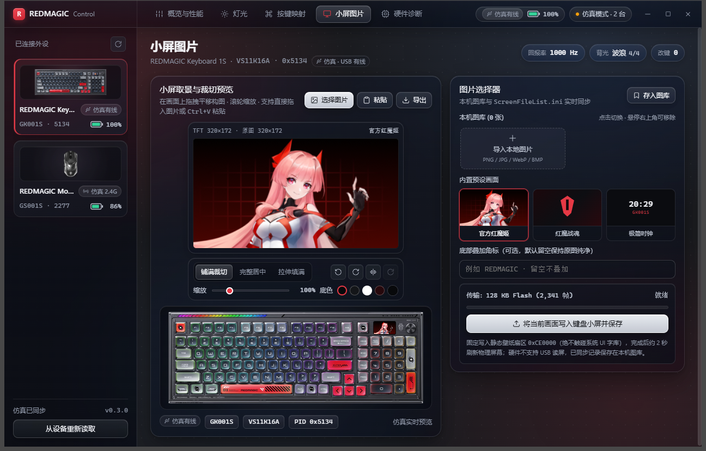
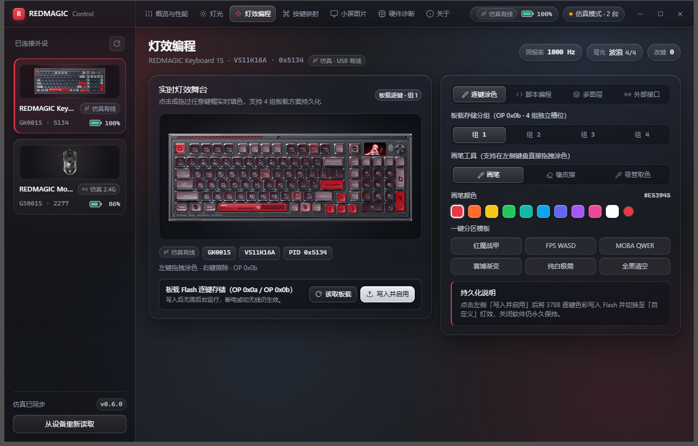
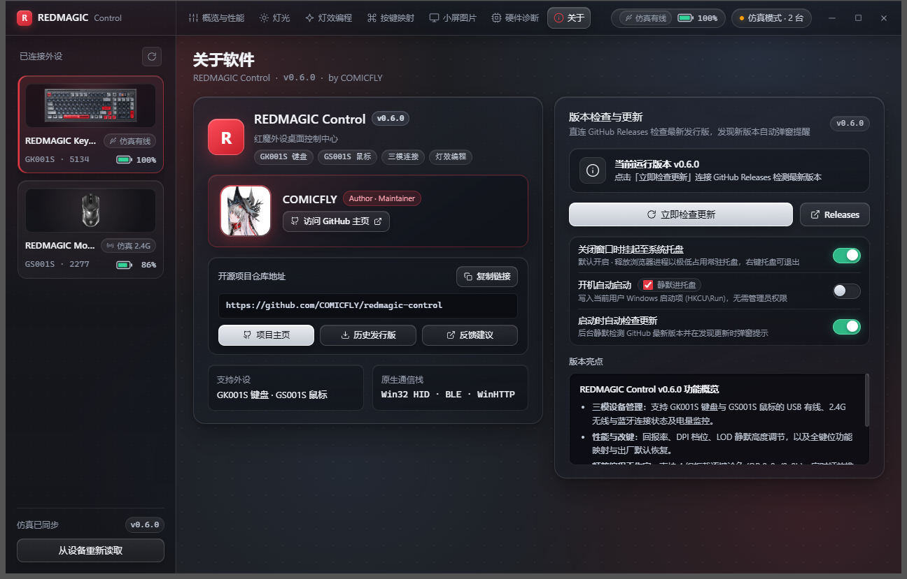

# REDMAGIC Control

红魔外设桌面控制中心，支持 **REDMAGIC 氘锋机械键盘 `GK001S`** 与 **REDMAGIC 电竞鼠标 `GS001S`** 的有线 / 2.4G / 蓝牙三模管理、按键映射、灯效编程与小屏图片同步。

## 界面预览


| 键盘灯光管理（20 种模式 + Logo 灯条） | 320×172 小屏图片选择器与裁切工作台 |
| :---: | :---: |
|  |  |

| 灯效编程工作室（脚本 / 图层 / 实时推流） | 板载逐键涂色（4 组 Flash 持久化方案） |
| :---: | :---: |
|  |  |

| GS001S 鼠标 · 5 档 DPI 与传感器控制 | 关于软件与在线更新 |
| :---: | :---: |
|  |  |

---

## 1. 支持设备与三模能力

### 1.1 设备标识与硬件参数

| 设备型号 | 产品名称 | 主控方案 | VID | 有线 PID | 2.4G 接收器 PID | 蓝牙识别特征 | 厂商 HID 通道 | 硬件键槽数 |
| :--- | :--- | :--- | :--- | :--- | :--- | :--- | :--- | :--- |
| **GK001S** | REDMAGIC Keyboard 1S | `VS11K16A` (+ nRF52 BLE) | `0x320F` / `0x0C45` | `0x5134` | `0x5135` | `GK001S 5.1` / PnP `0x05AC:0x024F` | Usage Page `0xFF1C`, Usage `0x92` | `126` 槽位 (`378 B`) |
| **GS001S** | REDMAGIC Mouse 1S | `VS11K17A` | `0x320F` / `0x0C45` | `0x2276` | `0x2277` | `GS001S` / `0x320F:0x2276/2277` | Usage Page `0xFF1C`, Usage `0x92` | `12` 槽位 (`36 B`) |

### 1.2 三模连接支持矩阵

| 功能模块 | USB 有线 (`56B/帧`) | 2.4G 无线接收器 (`24B/帧`) | 蓝牙 BLE (`HOGP + BAS`) |
| :--- | :---: | :---: | :---: |
| 设备识别与在线/休眠检测 | 支持 (`OP 0x1a`) | 支持 (`OP 0xaa` + `OP 0x50`) | 支持 (Win32 SetupAPI/CfgMgr32) |
| 实时电量与充电状态 | 支持 (`OP 0x1a`) | 支持 (`OP 0x1a`) | 支持 (GATT `0x180F` 系统属性) |
| 回报率 / DPI / LOD / 系统开关 | 支持 (`OP 0x05/0x06`) | 支持 (`OP 0x05/0x06`) | 只读（固件未开放蓝牙私有写通道） |
| RGB 灯光与 Logo 灯条控制 | 支持 (`OP 0x05/0x06`) | 支持 (`OP 0x05/0x06`) | 只读 |
| 板载逐键静态涂色（4 组 Flash） | 支持 (`OP 0x0a/0x0b`) | 支持 (`OP 0x0a/0x0b`) | 只读（板载方案依然生效） |
| 可编程灯效 / 音律 / 屏幕联动 / 本地 API | 支持 (`OP 0x12/0x28`, 30 FPS) | 支持 (`OP 0x12/0x28`, 8 FPS) | 仅界面预览 |
| 物理按键映射与出厂 ROM 恢复 | 支持 (`OP 0x07/0x08/0x09`) | 支持 (`OP 0x07/0x08/0x09`) | 只读 |
| GK001S 320×172 小屏壁纸写入 | 支持 (`OP 0x23/0x25`, 128 KB) | 仅支持本地裁切与存图库 | 仅支持本地裁切与存图库 |

> **蓝牙 BLE 模式说明**：`GK001S` 蓝牙模式下仅广播标准 `HOGP (0x1812)` 键盘服务与 `BAS (0x180F)` 电池服务，未开放 `0xFF1C / 0x92` 私有配置通道。蓝牙连接时自动读取实时电量并标记为只读。

---

## 2. 通信实现与协议规范

### 2.1 通信链路

- **USB / 2.4G HID 通道**（`src/devices/hid_win.rs`）：通过 Win32 `HidD_GetPreparsedData` + `HidP_GetCaps` 匹配 `UsagePage == 0xFF1C && Usage == 0x92` 接口，使用 `FILE_FLAG_OVERLAPPED` 异步读写与 `CancelIoEx` 超时取消。
- **蓝牙 BLE 通道**（`src/devices/bluetooth_win.rs`）：通过 `SetupDiGetClassDevsW` 与 `CM_Get_DevNode_PropertyW` 读取连接状态（`DEVPKEY_Device_IsConnected`）、MAC 地址与 `0x180F` 电池电量（`DEVPKEY_Bluetooth_Battery`）。
- **多链路优先级**（`src/devices/manager.rs`）：同一设备同时存在多条链路时按 `USB 有线 > 2.4G 在线 > 蓝牙已连接 > 2.4G 休眠` 自动选路，也可在「硬件诊断」页手动切换。

### 2.2 64 字节固定帧格式

所有 USB 有线与 2.4G 无线控制报包均使用固定 **64 字节** 的 HID Output / Input Report（`src/protocol/frame.rs`）：

| 字节区间 | 字段名 | 类型 / 说明 |
| :--- | :--- | :--- |
| `[0]` | `Report ID` | 固定 `0x04` |
| `[1..3]` | `Checksum` | `uint16_le` 累加校验和：`sum(frame[3..64]) & 0xFFFF` |
| `[3]` | `Opcode` | 指令码（见下表） |
| `[4]` | `Length` | 本包有效负载长度：USB 有线 `<= 0x38 (56 B)`，2.4G 无线 `<= 0x18 (24 B)` |
| `[5..7]` | `Offset Low` | `uint16_le` 偏移地址低 16 位（`off & 0xFFFF`） |
| `[7]` | `Offset High / Status` | **发送时**：24 位偏移高 8 位 `(off >> 16) & 0xFF`；**接收时**：普通指令状态码（`0x00 = OK`） |
| `[8..64]` | `Payload` | 有效数据区（最多 `56 B`，不足补 `0x00`） |

### 2.3 指令集（Opcode）

| Opcode | 名称 | 说明 |
| :--- | :--- | :--- |
| `0x01` / `0x02` | `TX_BEGIN` / `TX_COMMIT` | Flash 写事务开始与提交 |
| `0x03` | `READ_INFO` | 读取设备能力块（`AA 55` 头） |
| `0x05` / `0x06` | `READ_CONFIG` / `WRITE_CONFIG` | 读写板载配置块（GK001S `50 B` / GS001S `84 B`） |
| `0x07` | `READ_KEYMAP_ROM` | 读取出厂默认键表 |
| `0x08` / `0x09` | `READ_KEYMAP_USER` / `WRITE_KEYMAP` | 读写用户键表（`126 × 3 B` / `12 × 3 B`） |
| `0x0A` / `0x0B` | `READ_CUSTOM_RGB` / `WRITE_CUSTOM_RGB` | 读写板载逐键静态 RGB（4 组槽位，偏移 `group * 0x200`，`378 B`，`light.mode = 18`） |
| `0x12` | `STREAM_KEY_RGB` | 实时 RAM 逐键灯效推流（`378 B`，无需 `0x01/0x02` 事务，零 Flash 损耗，`light.mode = 29`） |
| `0x1A` | `POLL_STATUS` | 查询电量与充电状态：`data[0] = 0..100 (%)`，`data[1] = 0 放电 / 1 充电 / 2 满电` |
| `0x23` / `0x25` | `PREPARE_SCREEN_IMG` / `WRITE_SCREEN_IMG` | GK001S 静态小屏壁纸握手与流式写入（24-bit 偏移 `0x000000..0x01FFFF` → Flash `0xCE0000`） |
| `0x28` | `STREAM_LOGO_RGB` | 实时 RAM 顶部 20 颗 Logo 灯条推流（`60 B`，无需事务，零 Flash 损耗，`logo.mode = 5`） |
| `0x50` | `WIRELESS_NACK` | 2.4G 接收器休眠/离线回包 |
| `0xAA` | `HEARTBEAT` | 2.4G 无线在线探测（在线返回 `data[0] == 0xFF`） |

### 2.4 配置块字节布局（GK001S 50B / GS001S 84B）

#### GK001S 键盘配置块（`50 B`，`src/devices/keyboard.rs`）

| 偏移 | 字段 | 说明 |
| :--- | :--- | :--- |
| `0` | `profile` | 板载配置档位 |
| `1..8` | `light.*` | 模式 (`0..19`, `18=自定义`, `29=RAM直推`)、亮度 (`0..4`)、速度 (`2 - ui_speed`)、方向、多彩标志、`R, G, B` |
| `19 / 21 / 32 / 33` | `system.*` | WASD 互换 (`19`)、锁 Win (`21`)、低功耗 (`32`)、禁用 Alt+F4 (`33`) |
| `22` | `system.pollingRate` | 回报率：`0=1000Hz, 1=500Hz, 2=250Hz, 3=125Hz` |
| `27` | `light.customGroup` | 板载逐键自定义 RGB 激活组（`0..3`） |
| `28 / 34..39` | `logo.*` | 顶部 Logo 灯条模式 (`0/1/2/3/8`, `5=RAM直推`)、`R, G, B`、亮度 (`0..4`)、速度 (`3 - ui_speed`)、七彩循环 |
| `29 / 31 / 42..47` | `screen.*` | 动图标志、帧数、壁纸槽位标志与激活槽位 |
| `40 / 41` | `sleep / screenSleep` | 键盘休眠与小屏息屏时长索引 |

#### GS001S 鼠标配置块（`84 B`，`src/devices/mouse.rs`）

| 偏移 | 字段 | 说明 |
| :--- | :--- | :--- |
| `1..8` | `light.*` | 鼠标灯效模式 (`0..4`)、亮度、速度、方向、多彩开关、`R, G, B` |
| `10 / 11` | `polling24g / pollingWired` | 回报率：`0=125, 1=250, 2=500, 3=1000, 4=2000, 5=4000, 6=8000 Hz` |
| `12 / 13` | `activeDpi / lod` | 当前 DPI 档位 (`0..4`)、LOD 静默高度 (`1..2 mm`) |
| `14..58` | `dpiStages[0..5]` | 5 档 DPI，每档 9 字节：`enabled, xySplit, dpiX(u16_le), dpiY(u16_le), RGB` |
| `62 / 65..66` | `ripple / sleepSec` | 波纹控制 (`0/1`)、休眠时长 (`u16_le` 秒) |

### 2.5 键位映射、小屏壁纸与可编程灯效

- **3B 键位编码**（`src/protocol/usage.rs`）：`0x20 + mod + hid_usage`（键盘按键）、`0x10 + btn + 0x00`（鼠标键）、`0x13 + op + 0x00`（DPI 切换）、`0x30 + hi + lo`（多媒体）、`0xA00000`（禁用）。
- **320×172 小屏烧录**（`src/devices/keyboard.rs`）：画布输出转 Big-Endian RGB565（`110,080 B`）并补齐 `128 KB`，经 `OP 0x23` 握手与 `OP 0x25` 分 2,341 帧写入 `0xCE0000` 静态壁纸扇区（首包擦除等待 `1000 ms`，尾包静默 `2100 ms` 触发刷新），同时双向同步 `%LOCALAPPDATA%\Goper\keyboard\ScreenFileList.ini`。
- **可编程灯效与本地 API**（`src/studio/`）：
  - **板载逐键涂色**：`OP 0x0a/0x0b` 读写 4 组 `378 B` 板载方案，断电与无线模式持久生效。
  - **实时 RAM 推流**：`OP 0x12 (378 B)` + `OP 0x28 (60 B)` 直写易失 RAM，内置 6 套灯效脚本、4 图层混合器（动态渐变 / WASAPI 16 段音频频谱 / 16×6 屏幕取色 / 全局按键涟漪），停止推流或退出时自动还原原板载灯效。
  - **本地外部控灯桥**（仅绑定 `127.0.0.1`）：UDP `27650`（`b"RMGB" + flags + 378B/60B` 二进制帧或 JSON）及 HTTP/WebSocket `27651`（`GET /api/status`、`POST /api/rgb`、`WS /ws`）。

---

## 3. 构建与运行

```powershell
# 运行单元测试
cargo test

# 命令行设备只读探测 / 检查更新
cargo run -- --probe
cargo run -- --check-update

# 仿真模式运行界面
$env:MOCK_MODE="1"; cargo run

# 构建 Release 可执行文件（输出：target\release\redmagic-control.exe）
cargo build --release
```
